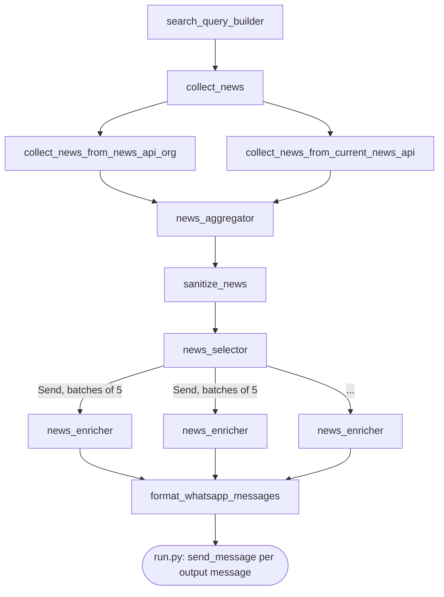

# Architecture 🏗️

The newsletter is a single [LangGraph](https://langchain-ai.github.io/langgraph/) `StateGraph`
(`src/daily_news_letter/workflow.py`). Each node is a plain function that receives the shared
state and returns a partial update. `run.py` invokes the graph once and sends the resulting
messages to WhatsApp.

## State

Defined in `models.py` as `NewsExtractorState` (a `TypedDict`):

| Key               | Type                        | Reducer        | Written by                     |
| ----------------- | --------------------------- | -------------- | ------------------------------ |
| `search_queries`  | `list[str]`                 | overwrite      | `search_query_builder`         |
| `news`            | `list[NewsArticle]`         | `operator.add` | both collectors                |
| `sanitized_news`  | `list[NewsArticle]`         | overwrite      | `sanitize_news`, `news_selector` |
| `enriched_news`   | `list[EnrichedNewsArticle]` | `operator.add` | each `news_enricher` batch     |
| `output_messages` | `list[list[str]]`           | overwrite      | `format_whatsapp_messages`     |

The `operator.add` reducers are what let parallel branches write to the same key: the two
collectors and the enricher batches each return their own slice and LangGraph concatenates them.
A consequence is that a node must **not** echo an accumulated list back (that would append it to
itself), which is why `news_aggregator` returns an empty update.

## Nodes

| Node | Module | What it does |
| --- | --- | --- |
| `search_query_builder` | `agents/search_query_builder.py` | Asks Gemini (structured output → `SearchQueries`) for ≥5 targeted queries on tech, AI and India news. Returns fixed queries in mock mode. |
| `collect_news` | `agents/news_collector.py` | No-op fan-out point so both sources run in parallel. |
| `collect_news_from_news_api_org` | `agents/news_collector.py` | Calls NewsAPI `/v2/everything` for the last 7 days. Queries are combined as `(w1 AND w2) OR (...)`. |
| `collect_news_from_current_news_api` | `agents/news_collector.py` | Calls Currents `/v1/search` for a fixed set of AI queries and dedupes by article ID. |
| `news_aggregator` | `agents/basic.py` | Join point after both collectors; logs the count. |
| `sanitize_news` | `agents/news_sanitizer.py` | Strips HTML to plain text (stdlib `HTMLParser`), decodes entities, removes NewsAPI's `[+N chars]` marker, normalizes dates to ISO-8601 UTC. |
| `news_selector` | `agents/news_selector.py` | Drops empty articles, dedupes across sources by URL or headline, keeps the 30 most recent. |
| `enrich_news_router` | `agents/news_enricher.py` | Conditional edge that splits the selection into batches of 5 and dispatches them with `Send`, so batches are enriched concurrently. |
| `news_enricher` | `agents/news_enricher.py` | Gemini rewrites headline/sub-headline/content for readability and assigns a category (structured output → `OutputEnrichedNewsArticleList`). |
| `format_whatsapp_messages` | `agents/message_formatter.py` | Renders each article with a Jinja template and packs them into messages under WhatsApp's size limit (4080 chars incl. separators). An article that doesn't fit starts a new message; a single oversized article is truncated. |

## External services (`api.py`, `llm.py`)

- **NewsAPI.org**: key sent in the `X-Api-Key` header (`NEWS_API_ORG`).
- **Currents API**: key sent in the `Authorization` header (`CURRENT_API_SERVICES`).
- **WhatsApp Cloud API**: `POST /v22.0/{sender_id}/messages` with a Bearer token.
- **Gemini** (`gemini-2.0-flash-lite`) via `langchain-google-genai`. The client is created lazily
  by `get_llm()`, so importing the package needs no API key.

All HTTP calls use a 15 s timeout. News API calls also use `raise_for_status()`. A missing env var
raises an error naming the variable (see below for how each case is handled).

## Failure handling (current behavior)

- If a news source fails (HTTP error, timeout or missing API key), its collector logs the error and
  contributes no articles; the other source still runs.
- Articles that fail validation (e.g. missing title) are skipped individually.
- LLM errors are **not** retried yet; a failed enrichment batch fails the run.
- A non-2xx WhatsApp response is logged with the status code and body, and the remaining messages
  are still sent. Missing WhatsApp config or a network error stops the run.

## Mock mode

`USE_MOCK_DATA=true` replaces both news APIs with bundled responses in
`src/daily_news_letter/mocks/data/` and skips the query-builder LLM call. Enrichment still calls
Gemini and `run.py` still sends to WhatsApp. The test suite instead substitutes a fake LLM, so
`pytest` needs no keys or network.

## Known limitations

These are tracked as next steps rather than implemented:

- No retries or backoff for LLM and HTTP calls
- `print` instead of structured logging
- No scheduling: the run is triggered externally (e.g. cron)
- Interests and sources are hard-coded in prompts and `api.py`, not per-user configuration
- No memory across runs, so the same story can appear on consecutive days
- WhatsApp is the only delivery channel
