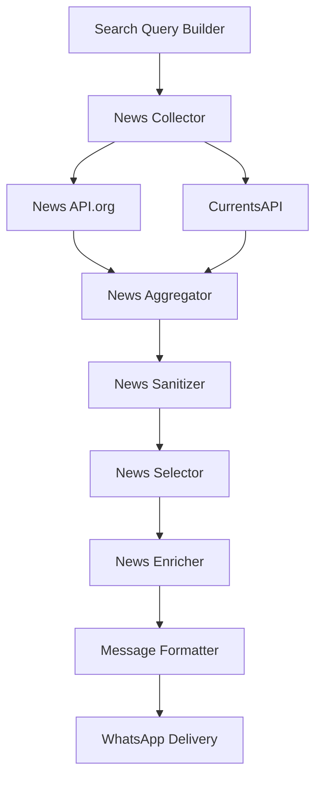

# Architecture Guide 🏗️

This document provides a comprehensive overview of the Daily AI Newsletter Agent's architecture, design patterns, and system components.

## System Overview

The Daily AI Newsletter Agent is built using a **multi-agent architecture** powered by **LangGraph**, where specialized agents work together in a coordinated workflow to deliver personalized AI newsletters.



## Core Architecture Principles

### 1. Agent-Based Design
- **Separation of Concerns**: Each agent handles a specific task
- **Modularity**: Agents can be modified independently
- **Scalability**: Easy to add new agents or data sources
- **Testability**: Individual agents can be tested in isolation

### 2. Workflow Orchestration
- **LangGraph Integration**: Manages agent coordination and state
- **State Management**: Shared state across all agents
- **Error Handling**: Graceful failure recovery
- **Checkpointing**: Workflow state persistence

### 3. Data Flow Architecture
- **Immutable State**: State updates through functional transformations
- **Type Safety**: Pydantic models for data validation
- **Streaming**: Efficient data processing through the pipeline

---

## Component Architecture

### 1. Workflow Engine (`workflow.py`)

The central orchestrator built on LangGraph:

```python
def create_workflow():
    memory = MemorySaver()
    builder = StateGraph(NewsExtractorState)
    
    # Define nodes and edges
    builder.add_node(Nodes.SEARCH_QUERY_BUILDER, agents.search_query_builder)
    builder.add_node(Nodes.COLLECT_NEWS, agents.collect_news)
    # ... more nodes
    
    # Define workflow edges
    builder.add_edge(Nodes.SEARCH_QUERY_BUILDER, Nodes.COLLECT_NEWS)
    # ... more edges
    
    return builder.compile(checkpointer=memory)
```

**Key Features:**
- **State Graph**: Defines agent execution order
- **Memory Saver**: Persists workflow state
- **Conditional Edges**: Dynamic routing based on conditions
- **Error Recovery**: Built-in error handling and retries

### 2. Agent System (`agents/`)

#### 2.1 Search Query Builder (`search_query_builder.py`)
**Purpose**: Generates targeted search queries for AI/tech news

```python
def search_query_builder(state: NewsExtractorState) -> NewsExtractorState:
    # Uses LLM to generate search queries based on interests
    queries = llm.invoke(SEARCH_QUERY_BUILDER_PROMPT)
    return {"search_queries": SearchQueries(search_queries=queries)}
```

**Responsibilities:**
- Generate diverse search queries
- Focus on AI, technology, and current events
- Optimize for news API search effectiveness

#### 2.2 News Collector (`news_collector.py`)
**Purpose**: Orchestrates news collection from multiple sources

```python
def collect_news(state: NewsExtractorState) -> NewsExtractorState:
    # Triggers parallel collection from multiple sources
    return {"news": []}  # Aggregated by child collectors

def collect_news_from_news_api_org(state: NewsExtractorState):
    # Fetches from NewsAPI.org
    
def collect_news_from_current_news_api(state: NewsExtractorState):
    # Fetches from CurrentsAPI
```

**Responsibilities:**
- Coordinate multiple news sources
- Handle API rate limits and errors
- Normalize data from different sources

#### 2.3 News Sanitizer (`news_sanitizer.py`)
**Purpose**: Cleans and normalizes article content

```python
def sanitize_news(state: NewsExtractorState) -> NewsExtractorState:
    sanitized = []
    for article in state["news"]:
        # Clean HTML, normalize dates, validate content
        clean_article = sanitize_article(article)
        sanitized.append(clean_article)
    return {"sanitized_news": sanitized}
```

**Responsibilities:**
- Remove HTML tags and malicious content
- Normalize date formats
- Validate article completeness
- Handle encoding issues

#### 2.4 News Selector (`news_selector.py`)
**Purpose**: Filters and selects the most relevant articles

```python
def news_selector(state: NewsExtractorState) -> NewsExtractorState:
    # Apply filtering logic
    selected = filter_articles(
        state["sanitized_news"],
        max_articles=10,
        recency_weight=0.7,
        relevance_threshold=0.6
    )
    return {"enriched_news": selected}
```

**Responsibilities:**
- Remove duplicates and low-quality content
- Apply relevance scoring
- Limit article count for optimal newsletter length
- Prioritize recent and high-quality content

#### 2.5 News Enricher (`news_enricher.py`)
**Purpose**: Enhances articles using AI for better readability

```python
def news_enricher(state: NewsExtractorState) -> NewsExtractorState:
    enriched = []
    for article in state["enriched_news"]:
        # Use LLM to improve headlines and content
        enhanced = llm.invoke(NEWS_ENRICHMENT_PROMPT + article.content)
        enriched.append(enhanced)
    return {"enriched_news": enriched}
```

**Responsibilities:**
- Improve headline clarity and engagement
- Enhance content readability
- Add relevant categories
- Maintain factual accuracy

#### 2.6 Message Formatter (`message_formatter.py`)
**Purpose**: Formats articles for WhatsApp delivery

```python
def format_whatsapp_messages(state: NewsExtractorState) -> NewsExtractorState:
    formatted_messages = []
    for article in state["enriched_news"]:
        # Apply WhatsApp formatting template
        message = template.render(article=article)
        formatted_messages.append(message)
    return {"output_messages": formatted_messages}
```

**Responsibilities:**
- Apply WhatsApp message formatting
- Handle character limits
- Add emojis and visual elements
- Ensure mobile-friendly layout

### 3. Data Models (`models.py`)

#### 3.1 Core Models

```python
class NewsArticle(BaseModel):
    headline: str
    sub_headline: Optional[str] = None
    content: str
    metadata: Optional[Dict[str, Any]] = {}
    url: Optional[str] = None
    published_at: str
    author: Optional[str] = None

class EnrichedNewsArticle(NewsArticle):
    category: str

class NewsExtractorState(TypedDict):
    search_queries: SearchQueries
    news: Annotated[List[NewsArticle], operator.add]
    sanitized_news: List[NewsArticle]
    enriched_news: Annotated[List[EnrichedNewsArticle], operator.add]
    output_messages: List[str]
    formatted_news: Annotated[List[str], operator.add]
```

**Key Features:**
- **Type Safety**: Pydantic validation for all data
- **State Annotations**: LangGraph state management
- **Immutable Updates**: Functional state transformations
- **Extensibility**: Easy to add new fields

### 4. External Integrations (`api.py`)

#### 4.1 News API Clients

```python
class NewsApiSearch:
    BASE_URL = "https://newsapi.org/v2/{endpoint}"
    
    def get_news(self, queries: List[str], page_size: int = 5):
        # Fetch from NewsAPI.org
        
class CurrentNewsApiSearch:
    BASE_URL = "https://api.currentsapi.services/v1/search"
    
    def get_news(self, search_query: str, page_size: int = 5):
        # Fetch from CurrentsAPI
```

#### 4.2 WhatsApp Integration

```python
def send_message(message: str):
    # Send formatted message via WhatsApp Business API
    resp = requests.post(
        f"https://graph.facebook.com/v22.0/{account_id}/messages",
        json=whatsapp_payload
    )
    return resp
```

### 5. AI Integration (`llm.py`)

```python
from langchain_google_genai import ChatGoogleGenerativeAI

gemini_llm = ChatGoogleGenerativeAI(model="gemini-2.0-flash-lite")
```

**Features:**
- **Google Gemini Integration**: Advanced AI capabilities
- **Prompt Engineering**: Optimized prompts for news processing
- **Error Handling**: Graceful AI service failures
- **Rate Limiting**: Respect API quotas

---

## Data Flow

### 1. Input Processing
```
User Trigger → Environment Variables → Search Query Generation
```

### 2. News Collection
```
Search Queries → Multiple APIs → Raw Articles → Aggregation
```

### 3. Content Processing
```
Raw Articles → Sanitization → Selection → AI Enhancement
```

### 4. Output Generation
```
Enhanced Articles → WhatsApp Formatting → Message Delivery
```

### 5. State Management
```
NewsExtractorState: {
    search_queries: SearchQueries
    news: List[NewsArticle]           # Aggregated from APIs
    sanitized_news: List[NewsArticle] # Cleaned content
    enriched_news: List[EnrichedNewsArticle] # AI-enhanced
    output_messages: List[str]        # WhatsApp-formatted
}
```

---

## Design Patterns

### 1. Agent Pattern
Each agent is a pure function that takes state and returns updated state:

```python
def agent_function(state: NewsExtractorState) -> NewsExtractorState:
    # Process state
    # Return updated state
    return updated_state
```

### 2. Pipeline Pattern
Sequential processing through specialized stages:
```
Input → Stage1 → Stage2 → Stage3 → Output
```

### 3. Strategy Pattern
Different implementations for similar functionality:
```python
class NewsApiSearch:  # Strategy 1
class CurrentNewsApiSearch:  # Strategy 2
```

### 4. Template Pattern
Consistent structure with customizable behavior:
```python
class BaseNewsCollector:
    def collect(self):
        data = self.fetch_data()  # Customizable
        return self.process_data(data)  # Customizable
```

---

## Error Handling Strategy

### 1. Graceful Degradation
- Continue workflow even if one news source fails
- Use mock data when APIs are unavailable
- Provide partial results rather than complete failure

### 2. Retry Logic
```python
@retry(max_attempts=3, backoff_factor=2)
def fetch_news_with_retry():
    # API call with automatic retries
```

### 3. Circuit Breaker
- Temporarily disable failing services
- Prevent cascade failures
- Automatic recovery detection

### 4. Logging and Monitoring
```python
import logging

logger = logging.getLogger(__name__)

def agent_with_logging(state):
    try:
        logger.info("Starting agent execution")
        result = process_state(state)
        logger.info("Agent completed successfully")
        return result
    except Exception as e:
        logger.error(f"Agent failed: {e}")
        raise
```

---

## Performance Considerations

### 1. Parallel Processing
- News collection from multiple sources runs in parallel
- LangGraph handles concurrent agent execution
- Async/await patterns for I/O operations

### 2. Caching Strategy
```python
# Cache search results to avoid redundant API calls
@lru_cache(maxsize=100)
def cached_news_fetch(query, date):
    return fetch_news(query, date)
```

### 3. Rate Limiting
```python
from ratelimit import limits, sleep_and_retry

@sleep_and_retry
@limits(calls=5, period=60)  # 5 calls per minute
def api_call():
    # Rate-limited API call
```

### 4. Memory Management
- Use generators for large datasets
- Implement pagination for API responses
- Clear intermediate state when possible

---

## Security Architecture

### 1. API Key Management
- Environment variables for sensitive data
- No hardcoded credentials
- Key rotation capabilities

### 2. Input Validation
```python
class NewsArticle(BaseModel):
    headline: str = Field(..., min_length=1, max_length=200)
    content: str = Field(..., min_length=10)
    url: Optional[str] = Field(None, regex=r'^https?://')
```

### 3. Content Sanitization
- HTML sanitization to prevent XSS
- Content filtering for inappropriate material
- URL validation and safety checks

### 4. Rate Limiting Protection
- Implement backoff strategies
- Monitor API usage
- Prevent abuse and overuse

---

## Scalability Considerations

### 1. Horizontal Scaling
- Stateless agent design enables easy scaling
- Database-backed state management for distributed systems
- Load balancing across multiple instances

### 2. Vertical Scaling
- Optimize memory usage in agents
- Efficient data structures
- Lazy loading of resources

### 3. Future Extensions
- Plugin architecture for new news sources
- Configurable agent pipelines
- Multi-language support
- Custom user preferences

---

## Testing Architecture

### 1. Unit Testing
```python
def test_news_sanitizer():
    # Test individual agent functionality
    state = create_test_state()
    result = sanitize_news(state)
    assert len(result["sanitized_news"]) > 0
```

### 2. Integration Testing
```python
def test_full_workflow():
    # Test complete workflow
    graph = create_workflow()
    result = graph.invoke({})
    assert "output_messages" in result
```

### 3. Mock Testing
```python
# Use mock data for testing without API calls
USE_MOCK_DATA = True
```

---

## Monitoring and Observability

### 1. Logging Strategy
- Structured logging with JSON format
- Different log levels for different environments
- Centralized log aggregation

### 2. Metrics Collection
- Agent execution times
- API response rates
- Message delivery success rates
- Error frequencies

### 3. Health Checks
```python
def health_check():
    return {
        "status": "healthy",
        "apis": check_api_health(),
        "last_run": get_last_successful_run(),
        "version": get_version()
    }
```

This architecture provides a robust, scalable, and maintainable foundation for the Daily AI Newsletter Agent, with clear separation of concerns and extensibility for future enhancements.